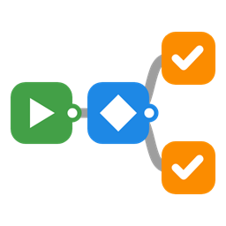
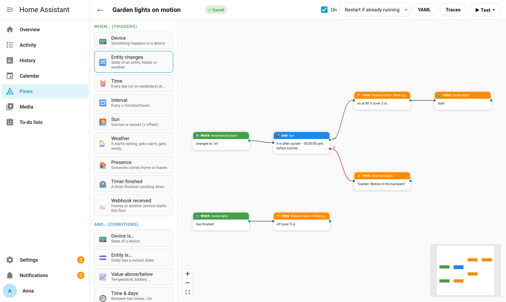
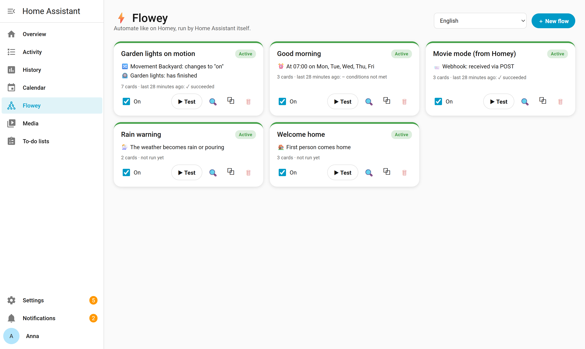
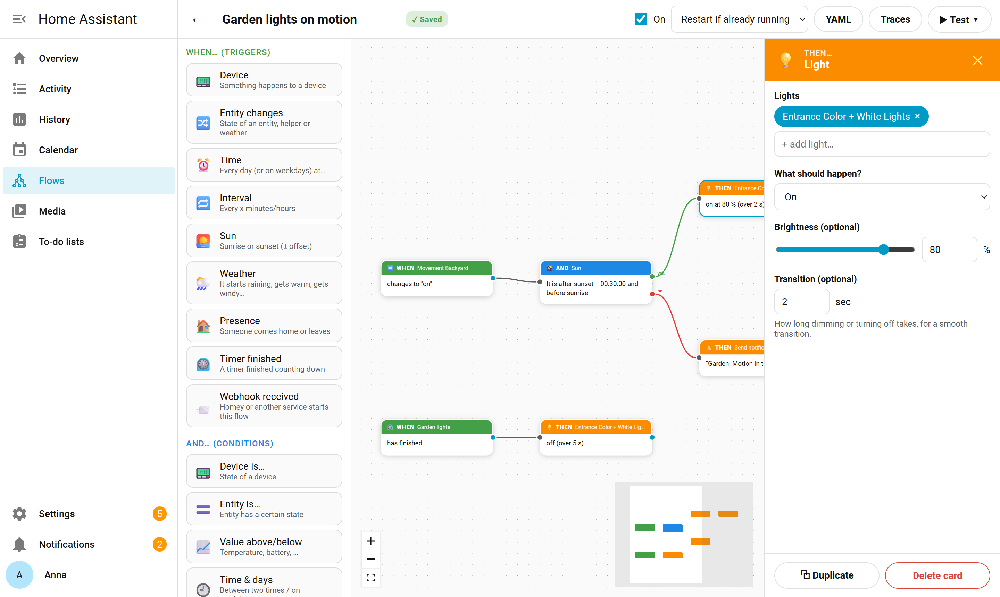

<p align="center">
  
</p>

<h1 align="center">Flowey</h1>

<p align="center">
  Homey-achtige <b>Advanced Flows</b> voor Home Assistant: bouw automatiseringen op een canvas,<br>
  opgeslagen als gewone Home Assistant-automations.
</p>

<p align="center">
  <a href="https://github.com/ThePonline/HA-Flowey/releases"></a>
  <a href="https://github.com/ThePonline/HA-Flowey/actions/workflows/validate.yml"></a>
  <a href="https://hacs.xyz"></a>
  <a href="LICENSE"></a>
</p>

<p align="center"><i><a href="README.md">English</a> · Nederlands</i></p>

<picture>
  <source media="(prefers-color-scheme: dark)" srcset="docs/images/editor-dark.png">
  
</picture>

Bouw automatiseringen met kaarten:
**ALS** (trigger) → **EN** (voorwaarde, met ja/nee-uitgang) → **DAN** (actie).

Kies eerst een apparaat, bijvoorbeeld "Haldeur sensor". Daarna zie je alleen de kaarten die bij dat apparaat horen, zoals "geopend", "gesloten" of "batterij laag". Die kaarten komen rechtstreeks uit Home Assistant en zijn in je eigen taal.

Elke flow wordt opgeslagen als **gewone Home Assistant-automation** in `automations.yaml` (id `flowey_…`). Home Assistant voert de flow dus zelf uit, met traces, run-modes en alles wat daarbij hoort. De visuele indeling (posities en verbindingen) bestaat alleen in dit paneel. Verwijder je het paneel, dan blijven je automations gewoon werken.

## Installeren

[](https://my.home-assistant.io/redirect/hacs_repository/?owner=ThePonline&repository=HA-Flowey&category=integration)

**Via HACS (aanbevolen)**

1. Klik op de knop hierboven, of ga naar *HACS → ⋮ → Custom repositories* en voeg `https://github.com/ThePonline/HA-Flowey` toe met type *Integration*.
2. Installeer **Flowey** en herstart Home Assistant.
3. Voeg de integratie toe: [](https://my.home-assistant.io/redirect/config_flow_start/?domain=ha_flow_builder)
   of ga naar *Instellingen → Apparaten & diensten → Integratie toevoegen → Flowey*.
4. In de zijbalk verschijnt **Flowey** (alleen voor beheerders).

**Handmatig**: download de nieuwste [release](https://github.com/ThePonline/HA-Flowey/releases), kopieer `custom_components/ha_flow_builder` naar `config/custom_components/` en ga verder bij stap 2.

**Vereisten**: Home Assistant 2024.10 of nieuwer, en `automation: !include automations.yaml` in je configuratie (dat staat standaard in elke installatie).

**Bijwerken vanaf HA Flow Builder** (0.12 en ouder): werk gewoon bij in HACS en herstart. Je flows, instellingen en automations blijven behouden; alleen de naam verandert.

## Schermafbeeldingen

<table>
  <tr>
    <td width="50%">
      <picture>
        <source media="(prefers-color-scheme: dark)" srcset="docs/images/overview-dark.png">
        
      </picture>
    </td>
    <td width="50%">
      <picture>
        <source media="(prefers-color-scheme: dark)" srcset="docs/images/inspector-dark.png">
        
      </picture>
    </td>
  </tr>
  <tr>
    <td align="center">Overzicht: status en laatste run van elke flow</td>
    <td align="center">Een kaart bewerken</td>
  </tr>
</table>

## Kaarten

| Als… | En… | Dan… |
|---|---|---|
| Apparaat (alle apparaattriggers van HA) | Apparaat is… | Apparaat (alle apparaatacties van HA) |
| Entiteit verandert (ook helpers) | Entiteit is… | Lamp (aan/uit, dimmen naar %, feller/donkerder, kleurtemperatuur, overgang) |
| | | Actie (elke HA-service) |
| Tijdstip (+ weekdagen) | Waarde boven/onder | Melding sturen (HA, telefoon, meldingsentiteit) |
| Interval | Tijd & dagen | Webhook (Homey-flow starten of elke URL aanroepen) |
| | | Wachten |
| Zon (op/onder ± verschuiving) | Zon (na/voor ± verschuiving) | |
| Weer (wordt regen/zonnig/…, temperatuur/wind/vochtigheid boven/onder) | Weer | |
| Aanwezigheid (iemand komt/vertrekt, eerste komt/laatste vertrekt, per zone) | Aanwezigheid (iemand/niemand, personen wel/niet in zone) | Wacht tot… (met maximum; uitgangen *gebeurd* / *tijd verstreken*) |
| Webhook ontvangen (bijv. vanuit Homey) | Timer loopt | Timer (starten, stoppen, pauzeren) |
| Timer afgelopen | | Herhaal (x keer, zolang/totdat; uitgangen *herhaal* / *klaar*) |
| | | Afstandsbediening (geleerde infrarood/RF-knop versturen) |

Regels op het canvas:
- Meerdere lijnen uit één uitgang lopen **parallel**.
- Meerdere triggers mogen op dezelfde kaart uitkomen ("A **of** B → doe X").
- Paden samenvoegen ná een voorwaarde of actie kan in v1 niet (de editor staat het niet toe).

## Recept: licht op beweging

Eén flow met twee triggers:

- **ALS** PIR *bezet* → **DAN** 💡 Lamp: aan op 40 %
- **ALS** *Entiteit verandert*: PIR van `on` naar `off`, **minstens 2 min lang** → **DAN** 💡 Lamp: uit (overgang 3 s)

Let op de richting: "van off naar on, 2 min lang" betekent "al 2 minuten beweging" en zet het licht dus uit terwijl je er nog bent.
Toont de Lamp-kaart dat HA een lamp niet als dimbaar ziet, dan negeert HA de helderheid; controleer dan in HA (Ontwikkelhulpmiddelen → Toestanden) de `supported_color_modes` van die lamp.

## Wacht tot…

De kaart **Wacht tot…** wacht tot er iets gebeurt (dezelfde keuzes als een ALS-kaart), eventueel met een maximale wachttijd.
Via **gebeurd** gaat de flow verder als het gebeurde, via **tijd verstreken** als het maximum bereikt is.

Voorbeeld licht op beweging in één flow: **ALS** beweging → 💡 aan → **Wacht tot** *geen beweging, 2 min lang* → 💡 uit.
Met de flow-instelling *Opnieuw starten als hij al loopt* begint het wachten opnieuw bij nieuwe beweging.
Let op: een lopende wachttijd overleeft geen herstart van Home Assistant.

## Timers (overleven een herstart)

Een **timer** is een HA-helper die aftelt, zoals Homey's Countdown. Maak hem direct in de kaart aan met *＋ Nieuwe timer*.
Robuuste variant van licht op beweging, met twee triggers:

- **ALS** beweging → 💡 aan + ⏲️ Timer *Nalooptijd* starten (opnieuw starten begint het aftellen opnieuw)
- **ALS** ⏲️ *Nalooptijd* afgelopen → 💡 uit

Anders dan *Wacht tot…* loopt een timer door als Home Assistant herstart; was hij intussen afgelopen, dan start de flow direct na de herstart.

## Herhaal

De kaart **Herhaal** herhaalt de kaarten aan de uitgang *herhaal* een vast aantal keer, of zolang/totdat een voorwaarde geldt (met een maximum als vangnet). Daarna gaat de flow verder via *klaar*.

## Handig

- **Test** vraagt bij een flow met meerdere triggers welke trigger je wilt nabootsen, en voert de flow uit alsof die gebeurde.
- **Kopiëren/plakken**: selecteer kaarten en gebruik Ctrl+C / Ctrl+V (ook naar een andere flow), of Ctrl+D / ⧉ *Dupliceren*. Een gekopieerde webhook-trigger krijgt automatisch een nieuw geheim adres.
- **Overzicht**: per flow zie je wanneer hij het laatst liep en of dat lukte; 🔍 opent de traces, ⧉ dupliceert de flow (de kopie staat uit tot je hem aanzet).

## Homey → Home Assistant (webhook ontvangen)

Met de ALS-kaart **Webhook ontvangen** start Homey (of een andere dienst) een flow in Home Assistant:

1. Voeg de kaart toe; er wordt een geheim adres gemaakt, bijv. `http://homeassistant.local:8123/api/webhook/flowey_…`.
2. Laat Homey een webverzoek (POST) naar dat adres sturen, bijvoorbeeld met een kaart uit de app *HTTP request flow cards*.
3. Meegestuurde gegevens gebruik je verderop met `{{ trigger.json.naam }}`.

Standaard werkt het adres alleen vanuit je eigen netwerk (Homey Pro). Voor Homey Cloud zet je dat uit en gebruik je het externe adres van Home Assistant (bijv. Nabu Casa). Het webhook-ID werkt als wachtwoord.

## Afstandsbediening (Broadlink, bijv. RM4 mini)

Heb je een Broadlink-apparaat in Home Assistant (integratie *Broadlink*), dan staat in het overzicht de knop **📡 Afstandsbediening**:

1. Vul een **naam** in (bijv. *lamp aan*) en eventueel een **groep** (bijv. *TV*), en kies **infrarood** of **RF 433 MHz**.
2. Klik **Leer knop** en volg de aanwijzing: richt je afstandsbediening op de RM4 en druk op de knop. Bij RF houd je de knop eerst ingedrukt (de frequentie wordt gezocht) en druk je daarna nog één keer.
3. Het **logboek** laat zien welke knop is geleerd, getest of verwijderd, en waarom iets mislukte (bijv. geen signaal binnen 30 seconden).

Gebruik de knop daarna in een flow met de DAN-kaart **Afstandsbediening**, bijvoorbeeld: **ALS** Tijdstip 19:00 → **DAN** Afstandsbediening *lamp aan*. De kaart wordt de gewone HA-actie `remote.send_command`; de codes blijven in de opslag van de Broadlink-integratie, dus ook zonder Flowey blijft alles werken.

## Apparaten hernoemen

Bij elke apparaatkaart staat **✏️ Apparaat hernoemen**. De naam wordt in Home Assistant zelf aangepast (net als via Instellingen → Apparaten) en is dus overal in HA zichtbaar. Entiteit-ID's blijven gelijk, zodat bestaande automations en dashboards blijven werken. Met *Oorspronkelijke naam herstellen* ga je terug naar de naam van de integratie.

## Homey-apparaten aansturen (webhook)

Met de kaart **Webhook** start je vanuit een flow een flow op je Homey:

1. Maak in Homey een flow die begint met de webhook-kaart (zoek bij een nieuwe flow op "webhook") en kies een eventnaam, bijv. `tuinlampen_aan`.
2. Kopieer de webhook-URL van Homey (formaat `https://webhooks.athom.com/webhook/<id>?homey=<homey-id>&event=<event>`) en plak die in de Webhook-kaart. Webhook-ID, Homey-ID en event worden dan automatisch ingevuld.
3. Druk op **Nu versturen (test)** om de koppeling te testen.

De tag kan een template zijn, bijv. `{{ states('sensor.temperatuur') }}`, en is in de Homey-flow te gebruiken.
Met **Andere webservice** roep je elke URL aan (GET/POST/PUT/PATCH/DELETE, headers, JSON- of tekstbody).
Onder water gebruikt de flow de actie `ha_flow_builder.call_webhook`, die je ook in gewone HA-automations kunt gebruiken.
Een mislukte aanroep (HTTP-fout, time-out) is zichtbaar in de trace van de automation.

Let op: headers (bijvoorbeeld een API-sleutel) worden net als de rest van de automation leesbaar opgeslagen in `automations.yaml`.

## Goed om te weten

- **Automatisch opslaan**: elke wijziging wordt na ongeveer een seconde opgeslagen. Een complete flow wordt direct in HA bijgewerkt; een onvolledige flow blijft een concept en de automation houdt zijn laatste werkende versie. Alleen kaarten verschuiven raakt HA niet.
- **Taal**: kies rechtsboven in het overzicht *Nederlands*, *English* of *zoals Home Assistant*. Ook de apparaatkaarten ("sensor geopend") volgen deze taal, los van de taal van je HA-profiel.

- **Gewijzigd in YAML**: bewerk je de automation buiten dit paneel (in YAML of de HA-editor), dan toont het paneel dat. Voordat opslaan vanaf het canvas die wijziging overschrijft, vraagt het paneel om bevestiging.
- **Concept**: een onvolledige flow wordt opgeslagen als concept en is nog niet actief.
- **▶ Test** voert de flow direct uit alsof de trigger gebeurde. Heeft elke trigger een eigen pad, dan vraagt de knop welke trigger je wilt nabootsen.
- **Laatste run**: stopte een flow omdat een EN-kaart niet klopte, dan staat er *voorwaarden niet voldaan*. Dat is geen fout.

## Ontwikkelen

```bash
# Frontend (Node 24)
cd frontend
npm install
npm test          # tests voor compiler en UI-logica (Vitest)
npm run build     # typecheck + bundel naar custom_components/ha_flow_builder/static/
npm run dev       # bouwt opnieuw bij elke wijziging

# Backend (Python 3.14), vanuit de hoofdmap
pip install -r requirements_test.txt
pytest            # integratietests tegen een echte Home Assistant-core
ruff check . && ruff format --check .
```

Structuur:
- `frontend/src/compiler/`: graph → HA automation config (zonder UI-afhankelijkheden en getest).
- `frontend/src/canvas/`: editor (React Flow), kaarten, palet.
- `frontend/src/inspector/`: formulieren per kaarttype, apparaat → kaart → extra velden.
- `frontend/src/api/ha.ts`: websocket/REST-aanroepen naar Home Assistant.
- `custom_components/ha_flow_builder/`: dunne integratie met panel, opslag van de canvas-indeling (met migratie vanaf v0.4) en websocket-API.
- `tests/`: backend-tests (pytest-homeassistant-custom-component).

Na een nieuwe build is een herstart van Home Assistant nodig voordat browsers de nieuwe bundel laden (cache-busting via `?v=`).

Lees [CONTRIBUTING.md](CONTRIBUTING.md) voordat je een pull request opent. Wat er per versie veranderde staat in [CHANGELOG.md](CHANGELOG.md).

## Licentie

Flowey heeft een **duale licentie**:

- **Gratis: [GNU AGPL-3.0](LICENSE).** Gebruik het thuis, pas het aan, deel het. Verspreid je een aangepaste versie, of draai je een aangepaste versie als dienst voor anderen, dan moet je je broncode onder dezelfde licentie publiceren.
- **Commerciële licentie.** Voor gebruik in een commercieel product of een commerciële dienst zonder de AGPL-verplichtingen (bijvoorbeeld in closed-source software, meegeleverd met hardware of als onderdeel van een betaalde installatieservice). Neem contact op met [@ThePonline](https://github.com/ThePonline) voor de voorwaarden.

De meegebundelde bibliotheken (React, React Flow, yaml) hebben een MIT-licentie; hun licentieteksten staan in [THIRD_PARTY_LICENSES.md](custom_components/ha_flow_builder/static/THIRD_PARTY_LICENSES.md).
